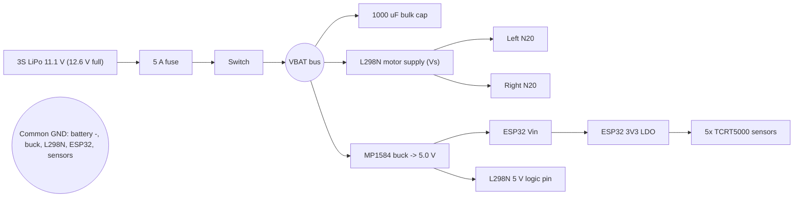

# BOM, power block, power budget (Tasks 4 and 5)

> **Before submitting:** prices are my planning estimates for the Indian hobby-electronics market (GST included),
> NOT live quotes. Open each item on Robu.in / Robocraze / Amazon.in, paste the real URL into `BOM.csv`, and update
> the unit price. The totals below must be recomputed from what you actually find. Motor stall current (0.8 A) is an
> assumption until you read the exact listing's spec.

## 1. Bill of materials (budget Rs 10,000)
| # | Item (exact model) | Qty | Unit Rs | Line Rs | Key spec / why |
|---|---|---|---|---|---|
| 1 | ESP32 DevKit V1 (ESP32-WROOM-32, 30-pin, CP2102) | 1 | 550 | 550 | Controller; 240 MHz dual core, 12-bit ADC, BLE+Wi-Fi (Task 7) |
| 2 | TCRT5000 reflective IR module, analog AO + LM393 | 6 | 70 | 420 | 5 for array + 1 spare; run from 3.3 V, read AO (analog) not DO |
| 3 | N20 12 V 300 RPM metal-gear motor | 2 | 380 | 760 | Light (~12 g), stall ~0.8 A (assumed, check listing), 12 V suits 3S |
| 4 | N20 motor bracket | 2 | 40 | 80 | Mounting |
| 5 | 43 mm rubber-tyre wheel for N20 (3 mm D-shaft) | 2 | 70 | 140 | Grip; ~0.52 m/s no-load at ~9.3 V |
| 6 | Metal ball caster 3/8 in | 1 | 80 | 80 | Low-friction 3rd contact point |
| 7 | L298N dual H-bridge motor driver module | 1 | 170 | 170 | 2 A/ch, Vs up to 46 V, matches Appendix A pin map |
| 8 | 3S 11.1 V 1000 mAh 25C LiPo, XT60 | 1 | 1000 | 1000 | 11.1 Wh, 25 A burst >> 1.9 A worst case |
| 9 | LiPo balance charger (iMAX B3-type, 2S/3S) | 1 | 1100 | 1100 | Mandatory for safe LiPo charging |
| 10 | LiPo low-voltage buzzer alarm (1-8S) | 1 | 150 | 150 | Stops over-discharge below ~3.3 V/cell |
| 11 | XT60 connector pair | 1 | 50 | 50 | Robot-side battery connector |
| 12 | Rocker switch 6 A | 1 | 35 | 35 | Main power |
| 13 | Blade fuse holder + 5 A fuse | 1 | 70 | 70 | Short-circuit protection (worst case 1.9 A) |
| 14 | MP1584EN buck module (set to 5.0 V) | 1 | 90 | 90 | Efficient 5 V for ESP32 Vin + L298N logic; avoids hot 78M05 |
| 15 | 3 mm acrylic chassis plate, laser cut (or 3D-print) | 1 | 450 | 450 | Custom 2-deck chassis |
| 16 | M3 standoff + screw kit | 1 | 150 | 150 | Mounting decks |
| 17 | Perfboard 5x7 cm | 2 | 25 | 50 | Sensor-array / power distribution board |
| 18 | Jumper wire set M-F + F-F 20 cm (40 pcs) | 2 | 70 | 140 | Prototyping connections |
| 19 | 22 AWG silicone wire 2 m (red/black) | 1 | 100 | 100 | Power wiring |
| 20 | Header strips + 2-pin screw terminals | 1 | 100 | 100 | Connectors |
| 21 | Capacitor kit: 1000 uF/25 V, 100 nF x10, 10 uF | 1 | 100 | 100 | Motor-rail bulk cap + decoupling |
| 22 | Heat-shrink, zip ties, double-sided tape | 1 | 100 | 100 | Assembly |
| 23 | Micro-USB cable | 1 | 80 | 80 | Programming |
| 24 | Velcro battery strap | 1 | 40 | 40 | Battery retention |
| | **Subtotal** | | | **6005** | |
| | Shipping (3-4 supplier orders) | | | 450 | |
| | Contingency 15 % (burnt driver, spare sensor, wrong part) | | | 970 | |
| | **TOTAL** | | | **7425** | Rs 2575 under budget; headroom could buy N20 motors **with encoders** (+~Rs 250 each) for the optional extension |

## 2. Why these choices (alternatives)
**Motor: N20 12 V 300 RPM vs TT "yellow" 3-6 V gear motor vs N20 6 V 600 RPM.**
L298N drops ~1.8-2.5 V, so motors see ~9.3 V at 11.1 V in. A 12 V N20 gives 300 x 9.3/12 ~ 232 RPM -> 232/60 x pi x 0.043 m ~ **0.52 m/s** no-load (~0.4 m/s loaded) - fast enough, controllable. TT motors are ~3x heavier, plastic gears, rated 3-6 V (would be over-volted on 3S), 150 RPM. 6 V N20 would need a buck for the motor rail (extra part, extra loss).

**Driver: L298N vs TB6612FNG vs DRV8833.** TB6612FNG (1.2 A cont / 3.2 A peak, MOSFET, ~0.5 ohm Ron) is *electrically better* (almost no voltage drop, cooler). DRV8833 maxes ~10.8 V, so it cannot take a 3S pack. I keep the L298N because (a) the competition's Appendix A pin map and test hardware are L298N, (b) 2 A/channel is 2.5x our 0.8 A stall so it survives bring-up abuse, (c) ready-made module with flyback diodes. Upgrade path: swap in TB6612FNG, same PWM/IN pins plus STBY tied high.

**5 V rail:** the L298N's on-board 78M05 is linear (dissipates (11.1-5) x I) and is rated for <=12 V in with the jumper; a fresh 3S is 12.6 V. So I remove the 5 V-EN jumper and feed the L298N logic pin and ESP32 Vin from a 5 V buck (MP1584).

## 3. Power-block diagram

## 4. Power budget (Task 5)
Definitions: *idle* = powered, motors stopped; *peak* = both motors stalled + radios transmitting. 5 V-rail loads are referred to the battery via the buck (90 % efficient): I_batt = 5 V x I_5V / (0.9 x 11.1 V).

| Load | Rail | Idle | Typical run | Peak / stall |
|---|---|---|---|---|
| ESP32 devkit (CPU, CP2102, LED) | 5 V | 80 mA | 90 mA | 350 mA (Wi-Fi TX burst; BLE ~130 mA) |
| 5x TCRT5000 (IR LED ~20 mA + LM393) via ESP32 3V3 LDO | 5 V (LDO passes same current) | 105 mA | 105 mA | 105 mA |
| L298N logic (Iss + LEDs) | 5 V | 20 mA | 25 mA | 50 mA |
| **5 V rail total** | | **205 mA** | **220 mA** | **505 mA** |
| -> battery side (x 5 V / 9.99 V) | 11.1 V | 103 mA | 110 mA | 253 mA |
| 2x N20 motors (battery side, series through L298N) | 11.1 V | 0 | 2 x 200 = 400 mA (assumed loaded average) | 2 x 800 = 1600 mA |
| **Battery total** | | **~0.10 A** | **~0.51 A** | **~1.85 A (worst case)** |

Checks: 1.85 A on a 1 Ah pack = 1.85C, far below 25C. Fuse 5 A > 1.85 A, < wiring limit. L298N peak dissipation ~ (2 V x 0.8 A) x 2 = 3.2 W (module heatsink OK). Buck: 505 mA < MP1584 3 A.

**Runtime (typical):** usable capacity = 80 % x 1000 mAh = 800 mAh (stop at ~3.5 V/cell). t = 0.8 Ah / 0.51 A = **1.57 h ~ 94 min**. Assumptions: constant average load, 0.5C so negligible Peukert loss, 25 C. Worst case (stall forever, which is a fault) = 0.8 / 1.85 = 26 min. Idle-only = 0.8/0.103 = 7.8 h.

## 5. Chemistry comparison: 3S LiPo vs 3S1P 18650 Li-ion
| | 3S LiPo 1000 mAh | 3S1P 18650 (2500 mAh, e.g. 25R-class) |
|---|---|---|
| Energy | 11.1 Wh | 27.75 Wh |
| Pack mass | ~90 g | ~150 g (cells + holder + BMS) |
| Pack Wh/kg | ~123 | ~185 (Li-ion wins) |
| Max discharge | 25C = 25 A | ~20 A = 8C |
| Cost (approx.) | Rs ~1,000 (Rs ~90/Wh) | Rs ~950 (Rs ~34/Wh) |
| Shape | flat pouch, low CG | cylindrical, bulky holder |
| Safety | needs balance charger, puncture risk | more tolerant, built-in BMS |

**Choice: LiPo.** This robot needs ~0.5 A for a few-minute run: energy is not the constraint (1000 mAh gives 94 min), so Li-ion's better Wh/kg and Rs/Wh buy nothing. What matters is *mass at the capacity we need* (a LiPo is ~60 g lighter -> less inertia/better traction) and a flat low centre of gravity; the high C-rating is margin for the 1.85 A stall case. I'd switch to Li-ion only if runtime mattered more than weight. Cost of that choice: needs the Rs 1,100 balance charger and handling discipline (storage voltage, no puncture, alarm).
